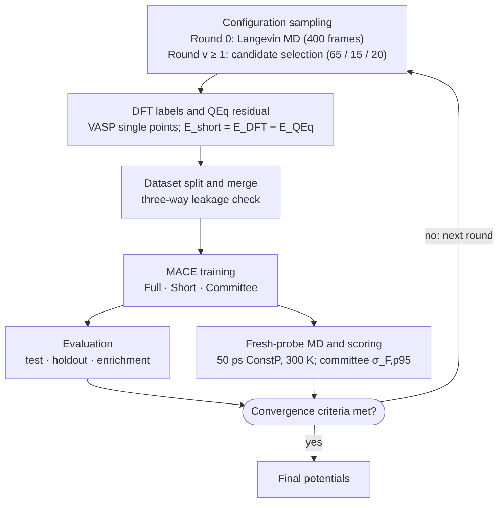

# MACE-QEq Active Learning Workflow for Metal | Solid Electrolyte Interfaces

An automated, uncertainty-driven active-learning (AL) workflow for constructing machine-learning interatomic potentials (MLIPs) of metal | solid-electrolyte interfaces under constant-potential (ConstP) conditions. Long-range electrostatics are treated explicitly by charge equilibration (QEq) with Particle-Mesh Ewald (PME) summation implemented in JAX, while the remaining short-range quantum-mechanical interaction is learned by the equivariant MACE architecture [7]. The scheme follows the residual-learning strategy of Hu et al. [1] and extends it from liquid to solid electrolytes, where metallic and ionic lithium cannot be separated by a bulk coordination criterion.

**Highlights**

- **Separation of length scales:** analytic QEq/PME electrostatics combined with a learned short-range residual.
- **Constant-potential MD:** electrode atoms are identified on the fly from graph connectivity and biased through an electronegativity shift.
- **Committee-driven active learning:** force-uncertainty-based candidate selection with leakage-free training, test, and holdout sets.
- **Automated HPC orchestration:** idempotent Slurm workflow with self-healing DFT job management.

---

## 1. Methodology

### 1.1 Energy and Force Partitioning

Local equivariant MLIPs act within a finite cutoff sphere (R_cut ≈ 5–6 Å) and cannot represent the long-range Coulomb and polarization response of a metal | electrolyte interface under bias. The total energy is therefore split into an explicit electrostatic term and a learned short-range residual:

$$
E_{\mathrm{total}}(\mathbf{R}) = E_{\mathrm{short}}(\mathbf{R}) + E_{\mathrm{QEq}}(\mathbf{R}, \mathbf{q}^{*})
$$

$$
\mathbf{F}_{\mathrm{total}} = -\nabla_{\mathbf{R}} E_{\mathrm{total}} = \mathbf{F}_{\mathrm{short}} + \mathbf{F}_{\mathrm{QEq}}
$$

where R denotes the atomic coordinates and q* the equilibrated partial charges (Sect. 1.2). The short-range model is trained on the DFT residual, with the QEq contribution evaluated at zero applied bias (ConstQ):

$$
E_{\mathrm{short}} = E_{\mathrm{DFT}} - E_{\mathrm{QEq}}^{\mathrm{ConstQ}}
$$

$$
\mathbf{F}_{\mathrm{short}} = \mathbf{F}_{\mathrm{DFT}} - \mathbf{F}_{\mathrm{QEq}}^{\mathrm{ConstQ}}
$$

During MD, the applied potential enters exclusively through the QEq term (Sect. 1.4). A "Full" MACE model, trained directly on E_DFT and F_DFT, is trained alongside as a benchmark.

### 1.2 Charge Equilibration with Particle-Mesh Ewald

The partial charges q* minimize the QEq energy functional [2] subject to a total-charge constraint, which is enforced with a Lagrange multiplier μ (the equalized electronegativity):

$$
E_{\mathrm{QEq}}(\mathbf{q},\mathbf{R}) = \sum_i \left(\chi_i q_i + \frac{1}{2}\eta_i q_i^2\right)
+ \frac{1}{2}\sum_{i\ne j} q_i q_j J_{ij}
+ \sum_i \frac{q_i^2}{2\sqrt{\pi}\sigma_i}
+ E_{\mathrm{dipole}}(\mathbf{q},\mathbf{R})
$$

$$
\mathbf{q}^{*} = \operatorname*{arg\,min}_{\mathbf{q}} E_{\mathrm{QEq}}(\mathbf{q},\mathbf{R}),
\qquad \text{subject to} \qquad \sum_i q_i = Q_{\mathrm{tot}}
$$

Here χᵢ and ηᵢ are the electronegativity and chemical hardness of atom i (Rappe–Goddard parameters [2]), and σᵢ is the width of a Gaussian charge distribution centred on atom i, set to its covalent radius [3]. The Coulomb interaction between two Gaussian charges is

$$
J_{ij}(r) = \frac{\operatorname{erf}\!\left(r/\sqrt{2\sigma_{ij}^{2}}\right)}{r}
$$

$$
\sigma_{ij} = \sqrt{\sigma_i^2 + \sigma_j^2}
$$

evaluated under three-dimensional periodic boundary conditions. The point-charge Coulomb sum is computed with the smooth PME method [4] (Ewald splitting parameter κ = 0.438 Å⁻¹, sixth-order B-spline interpolation, ≈ 1.2 mesh points/Å). A finite-range real-space correction, −erfc(rᵢⱼ/(√2σᵢⱼ))/rᵢⱼ, converts it into the Gaussian-charge interaction Jᵢⱼ. For slab geometries with vacuum along z (e.g. Li | Li₃N), the slab dipole correction [5, 6] is applied to net-neutral cells:

$$
E_{\mathrm{dipole}} = \frac{2\pi}{\Omega}\left(\sum_i q_i z_i\right)^2
$$

where Ω is the cell volume. Electrostatic energies are expressed in units of e²/(4π ε₀); multiplying by 14.3996 eV Å e⁻² gives eV. The constrained minimization is solved on GPU with L-BFGS in JAX, using exact gradients from automatic differentiation.

### 1.3 Force Consistency at the Constrained Minimum

At the constrained minimum, stationarity requires ∂E_QEq/∂qᵢ = μ for every atom i. The total derivative with respect to an atomic position therefore reduces to its explicit part, because the charge constraint removes all charge-response terms:

$$
\frac{\mathrm{d}E_{\mathrm{QEq}}}{\mathrm{d}\mathbf{R}_k}
= \frac{\partial E_{\mathrm{QEq}}}{\partial \mathbf{R}_k}
+ \sum_i \frac{\partial E_{\mathrm{QEq}}}{\partial q_i}\frac{\mathrm{d}q_i}{\mathrm{d}\mathbf{R}_k}
= \frac{\partial E_{\mathrm{QEq}}}{\partial \mathbf{R}_k}
+ \mu\frac{\mathrm{d}}{\mathrm{d}\mathbf{R}_k}\sum_i q_i
= \frac{\partial E_{\mathrm{QEq}}}{\partial \mathbf{R}_k}
$$

Hence F_QEq obtained by differentiating with respect to R at fixed q* (`jax.value_and_grad`) is the correct constrained-minimum force. The numerical check

$$
\max \left\|\mathbf{F}_{\mathrm{DFT}} - \left(\mathbf{F}_{\mathrm{short}} + \mathbf{F}_{\mathrm{QEq}}^{\mathrm{ConstQ}}\right)\right\|
\le 1\times10^{-10}\;\mathrm{eV}/\text{\AA}
$$

is a **decomposition consistency check** (numerical closure check), not an independent proof of the analytic Hellmann–Feynman force derivative: because F_short is defined as the DFT force residual, exact algebraic closure is expected up to floating-point and I/O precision. The constrained-minimum derivative argument above is the separate analytic justification.

### 1.4 Constant-Potential Molecular Dynamics

A constant electrode potential is imposed by shifting the electronegativities of the electrode atoms:

$$
\chi_i^{\mathrm{eff}} = \chi_i + \Delta\varphi_i
$$

$$
\Delta\varphi_i =
\begin{cases}
\Delta\varphi_{\mathrm{bottom}}, & i \in \text{bottom electrode},\\
\Delta\varphi_{\mathrm{upper}}, & i \in \text{upper electrode},\\
0, & \text{otherwise}.
\end{cases}
$$

The electrodes are not labelled in advance. Their classification is refreshed during MD according to the configured graph-update cadence.

**Step 1: Chemical exclusion.** An atom of the active-metal species M is a metallic candidate only if it has zero coordination with **every other element present in the cell**, excluding M itself. The set is therefore

$$
X_{\mathrm{other}} = \mathrm{Elements} \setminus \{\mathrm{ACTIVE\_METAL}\}
$$

All elements in X_other are treated by the same chemical-exclusion logic, regardless of whether they are anions or cationic framework species. Every element in X_other must therefore have a species-specific cutoff in `SE_ELEMENT_CUTOFFS`. Atoms of the mechanically fixed boundary layers (seeds) are always candidates.

$$
C = \left\{ i \;\middle|\; s_i=M \;\text{and}\; \sum_{X\in X_{\mathrm{other}}}\sum_{j\in X} \Theta\!\left(r_{\mathrm{cut}}(X)-d_{ij}\right)=0 \right\}
$$

This avoids the chemically ambiguous term "non-metal" for solid electrolytes containing framework cations such as La or Zr. A bulk metal–metal coordination criterion, such as CN_Li-Li ≥ 8 used for liquid electrolytes [1], is not used to assign the ConstP bias in solid electrolytes because framework cation–cation distances can overlap with metallic bond distances.

**Step 2: Graph percolation.** Candidates are connected by an edge whenever dᵢⱼ ≤ r_cut,metal (3.50 Å), and connected components are computed with SciPy sparse-graph routines. **Every component connected to a seed layer inherits the corresponding potential shift Δφ; no minimum cluster size is required for bias assignment.** Components connected to no seed are electronically isolated ("dead") metal and receive no shift. A component that connects both seed layers signals a dendritic short circuit and terminates the simulation.

The threshold N_cluster ≥ 8 is retained only where `get_system()` is used for automatic bulk/interface phase identification when explicit metadata are unavailable (e.g. in `evaluate_models.py` and `build_qeq_residual.py`). It is not a ConstP electrode-bias criterion.

**Step 3: Dual-cadence numerical trade-off.** Topological neighbor-list and percolation clusters are updated every N_cn_cadence = 10 steps, while QEq charge minimization is performed every N_qeq_cadence = 3 steps. Relative to updating both quantities every MD step, this reduces the nominal graph-update workload by about 90% and the QEq solver-call frequency by about 67%, at the cost of a small force lag between updates. The thermostat provides numerical stabilization of this controlled update lag; this is a computational/numerical trade-off rather than a claim of exact integration of an underlying Hamiltonian trajectory.

**Core physical invariants.** The following rules are implementation invariants, not tunable recommendations:

1. **Topological percolation:** an active-metal atom is a candidate only when its coordination with `X_other = Elements \ {ACTIVE_METAL}` is exactly zero. Seed-connected candidate components receive the corresponding potential bias; components not connected to a seed receive zero bias.
2. **Dipole boundary:** the Yeh–Berkowitz slab dipole correction is enabled only for asymmetric 2D slab/interface cells with vacuum along the selected axis (currently `z`). It is disabled for 3D bulk phases (`dipole_axis = None`, `E_dipole = 0`).
3. **Single source of truth:** all system-specific parameters, including species cutoffs, charges, quotas, paths, and related workflow settings, are defined in `al_config.py`. System changes must be made through this configuration layer rather than by editing stage or Slurm logic.

---

## 2. Active Learning Workflow

Reference labels are single-point VASP calculations [8] (PBE-D3(BJ), plane-wave cutoff 520 eV). In each round the models are trained, probed with fresh constant-potential MD, and either accepted as converged or enriched with the configurations on which the committee is least certain.



### 2.1 Bootstrap Sampling and Multi-GPU Execution

The Round-0 sampler `sample_v0.py` uses multiprocessing with the `spawn` context. The number of independent workers is

$$
N_{\mathrm{workers}} = \min(N_{\mathrm{GPUs}}, N_{\mathrm{tasks}})
$$

For example, `sample_v0.slurm` may request four physical NVIDIA A40 GPUs (`#SBATCH --gres=gpu:4`) for six configured trajectories:

| Task | Configuration |
| :---: | :--- |
| 0 | `test_Li` |
| 1 | `test_Li6PS5Cl` |
| 2 | `test_Li_Li6PS5Cl` |
| 3 | `tv_Li` |
| 4 | `tv_Li6PS5Cl` |
| 5 | `tv_Li_Li6PS5Cl` |

The first four tasks are assigned immediately to `cuda:0`–`cuda:3`, so **four MD trajectories run concurrently**. Tasks 4 and 5 remain in the FIFO task queue. When any worker finishes its current trajectory, it automatically dequeues the next task. Therefore, seeing only **4 of 6 `.traj` files initially is expected**: the remaining two files are created as soon as the first workers become available.

This queueing behaviour is independent of the total number of configured trajectories. Increasing the GPU allocation increases the number of concurrent workers up to the number of pending tasks.

### 2.2 Committee Uncertainty

Model uncertainty is estimated from a committee of M = 4 short-range MACE models (the principal model plus three seed replicas). For atom i, the force uncertainty is the committee standard deviation

$$
\sigma_{F,i} = \sqrt{\frac{1}{M}\sum_m \left\|\mathbf{F}_{m,i}-\bar{\mathbf{F}}_i\right\|^2}
$$

$$
\bar{\mathbf{F}}_i = \frac{1}{M}\sum_m \mathbf{F}_{m,i}
$$

and the frame-level indicator σ_F,p95 is the 95th percentile of σ_F,i over all atoms in the frame.

### 2.3 Candidate Selection

In each round v ≥ 1, exactly 100 configurations are selected from the scored probe trajectory:

| Subset | N | Selection rule | Minimum temporal separation |
| :--- | :---: | :--- | :--- |
| High uncertainty | 65 | Largest σ_F,p95 | Δt ≥ 0.357 ps (= 50 ps / 140) |
| Uniform coverage | 15 | Highest-uncertainty frame in each of 15 equal windows (3.33 ps) | Δt ≥ 0.033 ps |
| Independent holdout | 20 | One frame in each of 20 uniform windows; never used for training | Δt ≥ 0.100 ps from all enrichment frames |

The separation constraints suppress thermally correlated neighbours. The holdout frames serve as an out-of-sample benchmark in all subsequent generations. Before merging, the three-way split (training, test, holdout) is verified to be free of data leakage.

### 2.4 Convergence Criteria

Generation k is declared converged when all of the following criteria are satisfied:

| # | Criterion | Condition |
| :---: | :--- | :--- |
| 1 | Uncertainty target | Fraction of probe frames with σ_F,p95 ≥ 0.100 eV/Å is ≤ 1.0 % |
| 2 | Uncertainty ceiling | No probe frame with σ_F,p95 ≥ 0.150 eV/Å (0.0 %) |
| 3 | Test-set regression | Force RMSE on the independent test set increases by ≤ 10 % relative to the parent generation |
| 4 | Holdout preservation | Force RMSE on every historical holdout set increases by ≤ 20 % |
| 5 | Enrichment learning | Force RMSE of the Short+QEq model on the current enrichment set is strictly lower than that of the parent generation |

Criteria 1 and 2 are evaluated on a fresh 50 ps ConstP probe trajectory.

---

## 3. Repository Structure

```text
├── al_config.py                    # Single source of truth for system-specific settings
├── run_al.py                       # Orchestrator (Slurm DAG, idempotent execution)
├── structures/                     # Supercell POSCAR files (bulk phases, interface)
├── data/                           # Cumulative training, validation, test sets (extxyz)
├── trained_models/                 # Checkpoints of Full, Short, and Committee models
├── md_validation/                  # Per-round trajectories, scoring, and reports
└── active_learning/
    ├── slurm/                      # Slurm job templates, one per workflow stage
    ├── template/                   # DFT input templates (INCAR, KPOINTS, POTCAR)
    └── stages/                     # Python engines for the workflow stages
        ├── sample_v0.py            # Bootstrap Langevin sampler
        ├── run_md.py               # ConstP/ConstQ MD driver, graph-based electrodes
        ├── build_qeq_residual.py   # JAX PME-QEq solver, residual label generation
        ├── score_committee.py      # Committee force-uncertainty estimator
        ├── select_candidates.py    # Quota-based candidate selection (65/15/20)
        ├── prepare_dft.py          # Structure validation, POSCAR staging
        ├── dispatch_dft.py         # Self-healing Slurm VASP job manager
        ├── collect_dft.py          # vasprun.xml parser, geometry verification
        ├── merge_dataset.py        # Three-way leakage check, dataset merge
        ├── evaluate_models.py      # Cross-generation accuracy comparison
        ├── run_fresh_probe.py      # Fresh-probe MD wrapper
        ├── score_fresh_probe.py    # Fresh-probe trajectory scoring
        └── convergence_report.py   # Convergence evaluation, JSON report
```

---

## 4. Installation

**Requirements:** Python 3.10, CUDA 12.4 or newer, PyTorch (CUDA build), JAX with GPU support, MACE, ASE, a licensed VASP installation, and a Slurm scheduler.

```bash
# Create and activate the environment
conda create -n mace_qeq python=3.10 -y
conda activate mace_qeq

# PyTorch with CUDA 12.4
pip install torch torchvision --index-url https://download.pytorch.org/whl/cu124

# JAX with CUDA support
pip install -U "jax[cuda12]"

# ASE, MACE, and PME electrostatics kernels
pip install ase pandas scipy matplotlib
pip install mace-torch
pip install dmff
```

Site-specific software modules, CUDA, and Conda settings are defined in `active_learning/slurm/cluster_config.sh`. To verify the environment:

```bash
bash -c 'source active_learning/slurm/cluster_config.sh && load_gpu_environment'
```

---

## 5. Usage

The workflow is driven by the orchestrator `run_al.py`. It inspects the physical artifacts of each stage, skips completed stages, reuses active Slurm jobs, and chains the remaining stages with `afterok` dependencies.

**Pipeline status** (completed stages, active Slurm jobs, convergence metrics):

```bash
python run_al.py --status
```

**Launch or resume an active-learning round:**

```bash
# Auto-detect the target round and submit
python run_al.py --run-round

# Target an explicit generation index
python run_al.py --run-round 1
```

**Manual stage execution** (debugging):

```bash
# Candidate selection
export AL_STAGE=candidate_selection
python -m stages.select_candidates

# QEq residual construction
python -u stages/build_qeq_residual.py <input_dft.extxyz> \
    -o <output_short.extxyz> \
    --report <qeq_report.csv>
```

---

## 6. Key Hyperparameters

System-specific methodological parameters are defined exclusively in `al_config.py`. Defaults correspond to the Li | β-Li₃N baseline.

| Parameter | Default | Description |
| :--- | :--- | :--- |
| `RCUT_METAL` | 3.50 Å | Metal–metal cutoff for graph percolation |
| `SE_ELEMENT_CUTOFFS` | `{"N": 2.50}` Å | Active-metal cutoffs for all elements in X_other |
| `MIN_CLUSTER_SIZE` | 8 | Phase-identification threshold in `get_system()`; not used for ConstP bias assignment |
| `EXPLORATION_MODE` | `"constp"` | MD mode (`"constp"` or `"constq"`) |
| `BOTTOM_EXTERNAL_CHI` | 6.0 eV | Electronegativity shift of the bottom electrode |
| `UPPER_EXTERNAL_CHI` | −2.0 eV | Electronegativity shift of the upper electrode |
| `MD_PS` | 50.0 ps | Probe trajectory length |
| `CN_CADENCE` | 10 steps | Topological neighbor-list and graph-percolation update interval |
| `QEQ_UPDATE_EVERY` | 3 steps | QEq charge-minimization update interval |
| `TIMESTEP_FS` | 2.0 fs | MD time step |
| `N_HIGH` | 65 | High-uncertainty candidates per round |
| `N_COVERAGE` | 15 | Uniform-coverage candidates per round |
| `N_HOLDOUT` | 20 | Independent holdout frames per round |
| `HIGH_MIN_SPACING_PS` | 0.357 ps | Minimum separation between high-uncertainty frames |
| `MIN_HOLDOUT_DISTANCE_PS` | 0.100 ps | Minimum separation of holdout from enrichment frames |
| `CONV_SIGMA_P95_TARGET` | 0.100 eV/Å | Soft uncertainty threshold |
| `CONV_SIGMA_P95_HARD` | 0.150 eV/Å | Hard uncertainty threshold |

---

## 7. Illustrative Configuration: Na | Na₃PS₄

The following configuration is **illustrative only**. It demonstrates the required syntax for a chemically different metal | solid-electrolyte system; the numerical parameters must be validated against the target system rather than copied as production defaults.

```python
# System identity
ACTIVE_METAL = "Na"
SE = "Na3PS4"
SYSTEM = f"{ACTIVE_METAL}_{SE}"

# Topological percolation
# Illustrative value only; validate against Na-Na RDF / metallic structure.
RCUT_METAL = 3.80

# Chemical exclusion: every element other than ACTIVE_METAL must be listed.
SE_ELEMENT_CUTOFFS = {
    "P": 3.00,
    "S": 3.10,
}

# Illustrative Rappé–Goddard QEq parameters
CHI_HARDNESS_TABLE = {
    "Na": (-2.8500, 8.4000),
    "P":  ( 1.8000, 7.0946),
    "S":  ( 6.5745, 9.0000),
}
```

For Na, the illustrative `RCUT_METAL = 3.80 Å` is close to the 300 K BCC Na nearest-neighbour distance (about 3.72 Å) and may therefore be too restrictive under thermal fluctuations. A value around **4.25–4.30 Å** is a more appropriate starting range if a similar ~15% thermal/structural expansion margin is desired, but the final cutoff should be determined from the target system's RDF and validated against the intended metallic connectivity.

Likewise, an illustrative Na–S cutoff of **3.10 Å** lies close to the first Na–S coordination shell and may admit thermally fluctuating Na–S contacts into the chemical-exclusion test. The cutoff should therefore be chosen from the first minimum of the relevant RDF (typically around 3.40–3.60 Å for the stated example) and then validated against the actual trajectory.

These values are **not universal physical constants**. For every new chemical system, `RCUT_METAL` and `SE_ELEMENT_CUTOFFS` should be determined from the target structure/trajectory, RDF analysis, and validation of the resulting electrode classification.

---

## 8. References

1. Hu et al., *Nat. Commun.* **16**, 7379 (2025).
2. A. K. Rappe and W. A. Goddard III, Charge equilibration for molecular dynamics simulations, *J. Phys. Chem.* **95**, 3358 (1991).
3. P. Pyykkö and M. Atsumi, Molecular single-bond covalent radii for elements 1–118, *Chem. Eur. J.* **15**, 186 (2009).
4. U. Essmann et al., A smooth particle mesh Ewald method, *J. Chem. Phys.* **103**, 8577 (1995).
5. I.-C. Yeh and M. L. Berkowitz, Ewald summation for systems with slab geometry, *J. Chem. Phys.* **111**, 3155 (1999).
6. J. Neugebauer and M. Scheffler, Adsorbate–substrate and adsorbate–adsorbate interactions of Na and K adlayers on Al(111), *Phys. Rev. B* **46**, 16067 (1992).
7. I. Batatia et al., MACE: Higher order equivariant message passing neural networks for fast and accurate force fields, *Adv. Neural Inf. Process. Syst.* **35** (2022).
8. G. Kresse and J. Furthmüller, Efficient iterative schemes for ab initio total-energy calculations using a plane-wave basis set, *Phys. Rev. B* **54**, 11169 (1996).

---

## 9. License

Distributed under the MIT License.
